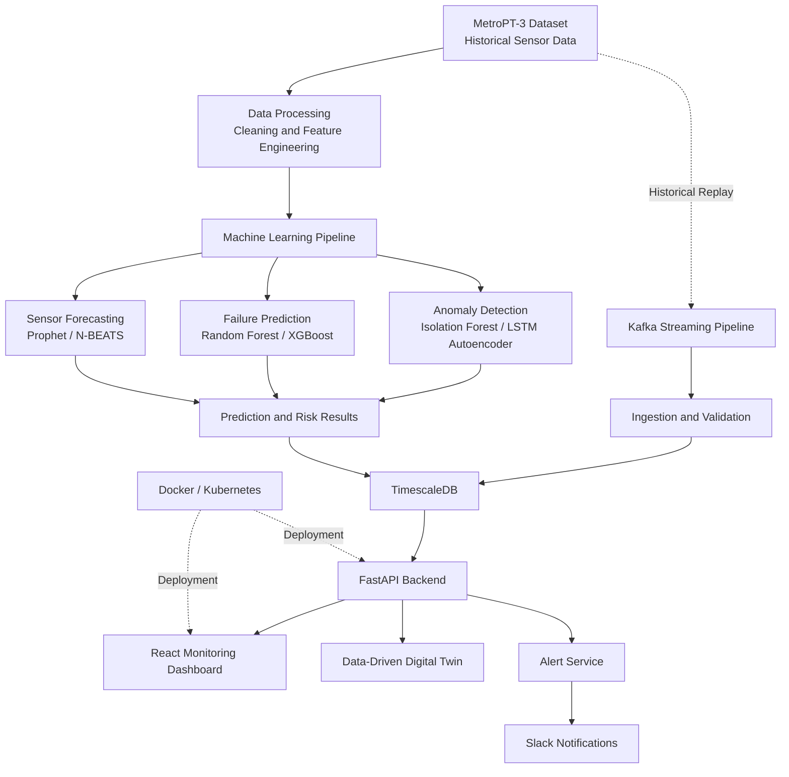

# Real-Time Predictive Maintenance for Metro Train Compressors

**An AI-powered predictive maintenance platform for detecting anomalies, predicting compressor failures, forecasting sensor behaviour, and monitoring equipment health.**

<!-- Replace this section with your dashboard screenshot when available -->
<!--  -->

[](https://www.python.org/)
[](https://fastapi.tiangolo.com/)
[](https://react.dev/)
[](https://scikit-learn.org/)
[](https://archive.ics.uci.edu/dataset/791/metropt+3+dataset)
[]()

## Overview

Unexpected equipment failures can disrupt metro operations, increase maintenance costs, and compromise operational reliability. Traditional maintenance approaches often depend on fixed schedules or respond only after a fault occurs.

**Real-Time Predictive Maintenance for Metro Train Compressors** aims to address this challenge by analysing sensor data from a metro train's Air Production Unit (APU) and identifying abnormal operating behaviour before it develops into a potential failure.

The system combines machine learning, time-series analysis, streaming data processing, and an interactive monitoring dashboard to support data-driven maintenance decisions.

Using the MetroPT-3 dataset, the project explores anomaly detection, failure-risk prediction, sensor forecasting, and a data-driven digital twin. The planned end-to-end platform connects the ML pipeline with a backend API, time-series database, streaming infrastructure, dashboard, and alert service.

## Key Features

- **Exploratory Data Analysis:** Analyse sensor distributions, operating cycles, correlations, missing values, and historical failure periods.
- **Anomaly Detection:** Identify unusual compressor behaviour using Isolation Forest and an LSTM autoencoder.
- **Failure Prediction:** Estimate the risk of a failure occurring within a configurable future time horizon.
- **Sensor Forecasting:** Forecast selected sensor values and compare predictions with actual readings.
- **Real-Time Data Pipeline:** Replay historical sensor readings through a streaming pipeline to simulate live equipment monitoring.
- **Interactive Dashboard:** Visualise sensor trends, anomaly scores, predicted failure risk, forecasts, and alert history.
- **Digital Twin:** Maintain a data-driven representation of compressor health and explore simulated what-if scenarios.
- **Remaining Useful Life Estimation:** Experiment with indicative estimates based on changes in health and failure-risk indicators.
- **Intelligent Alerts:** Send notifications with anomaly details, contributing sensor signals, severity, and example maintenance recommendations.
- **Containerisation and Deployment:** Package services with Docker and extend deployment to Kubernetes or a cloud environment.

> **Implementation note:** These features describe the project scope. Individual components are being developed and validated in phases; only features that have been implemented and tested should be marked as complete.

## System Architecture

The planned architecture follows a modular pipeline from historical sensor data to predictive insights and maintenance notifications.



### Architecture Components

| Component | Technology | Responsibility |
|---|---|---|
| Data source | MetroPT-3 CSV | Historical sensor readings and documented failure events |
| Data processing | Python, Pandas, NumPy | Cleaning, resampling, labelling, and feature engineering |
| Anomaly detection | Isolation Forest, PyTorch | Detect deviations from normal operating behaviour |
| Failure prediction | Scikit-learn, XGBoost | Estimate risk over a future time horizon |
| Forecasting | Prophet, optionally N-BEATS | Forecast selected sensor measurements |
| Streaming | Apache Kafka | Replay and process sensor events |
| Database | TimescaleDB | Store time-series readings, predictions, and alerts |
| Backend | FastAPI | Expose data and model outputs through REST APIs |
| Frontend | React, Recharts | Display sensor trends, risk indicators, and alerts |
| Digital twin | Python, model outputs, rules | Simulate operating scenarios and estimate equipment health |
| Notifications | Slack webhooks | Deliver actionable maintenance alerts |
| Deployment | Docker, Kubernetes | Package and deploy the application |

## Dataset

This project uses the **MetroPT-3 dataset**, which contains operational data collected from the Air Production Unit of a metro train.

- **Source:** [UCI Machine Learning Repository — MetroPT-3 Dataset](https://archive.ics.uci.edu/dataset/791/metropt+3+dataset)
- **Data volume:** Approximately 1.5 million rows.
- **Sensor variables:** 15 signals, comprising 7 analog and 8 digital signals.
- **Failure events:** Four documented air-leak failure events.
- **Data format:** CSV.

### Sensor Categories

**Analog signals**

| Sensor | Description |
|---|---|
| `TP2` | Pressure measurement |
| `TP3` | Pressure measurement |
| `H1` | Analog sensor signal |
| `DV_pressure` | Pressure-related signal |
| `Reservoirs` | Reservoir pressure-related measurement |
| `Oil_temperature` | Oil temperature |
| `Motor_current` | Compressor motor current |

**Digital signals**

`COMP`, `DV_eletric`, `Towers`, `MPG`, `LPS`, `Pressure_switch`, `Oil_level`, and `Caudal_impulses`.

The project uses documented failure intervals to create labels for model training and evaluation because the original sensor file does not directly provide the required failure labels.

### Data Processing Pipeline

1. Load the original CSV file and parse timestamps.
2. Check missing values, duplicate timestamps, irregular intervals, and sensor distributions.
3. Resample the sensor signals into time windows.
4. Examine normal compressor loading and unloading cycles.
5. Add verified failure intervals and generate failure-related labels.
6. Build features for anomaly detection and failure prediction.
7. Save processed data in Parquet format for efficient reuse.

**Important:** Compressor pressure changes can occur during normal operating cycles. An unusual sensor reading should not automatically be interpreted as a failure.

## Machine Learning Approach

### 1. Anomaly Detection

The anomaly detection module aims to identify operating conditions that differ from the compressor's learned normal behaviour.

**Isolation Forest**

- Provides a baseline unsupervised anomaly detector.
- Learns patterns from normal operating windows.
- Produces anomaly scores for identifying unusual sensor behaviour.

**LSTM Autoencoder**

- Learns to reconstruct sequences of sensor features.
- Uses reconstruction error as an anomaly score.
- Can capture temporal patterns that may not be represented by individual sensor readings.

The two approaches will be compared using precision-recall metrics, recall, false-alarm episodes, and detection lead time.

### 2. Failure Prediction

The failure prediction module estimates whether a failure may occur within a future time horizon.

Candidate models:

- Random Forest
- XGBoost
- Optional LSTM-based sequence classifier

Potential input features include rolling means, standard deviations, trends, and anomaly scores derived from historical sensor readings.

The prediction target can be configured for horizons such as 2, 6, 12, or 24 hours.

The model output is intended to provide a risk score between 0 and 1. This score represents estimated model risk and should not be interpreted as a guaranteed probability until calibration has been evaluated.

### 3. Sensor Forecasting

The forecasting module aims to predict future values of selected signals, such as `TP2` and `Oil_temperature`.

Candidate approaches:

- Prophet as a baseline forecasting model.
- N-BEATS as an optional advanced forecasting model.

Forecasts can include lower and upper uncertainty bounds. Evaluation will use chronological validation, rolling-origin testing, and metrics such as MAE and sMAPE.

### Model Evaluation Strategy

Industrial failures are rare, so accuracy alone is not a sufficient evaluation metric.

The planned evaluation includes:

- Precision and recall.
- F1-score.
- Precision-recall AUC (PR-AUC).
- False-alarm episodes.
- Failure detection lead time.
- Forecasting MAE and sMAPE.
- Performance across individual failure events.

The evaluation will use chronological splits and failure-aware validation to reduce data leakage. Results will be reported with the limitations of the small number of documented failure events.

## Real-Time Monitoring Pipeline

The planned streaming pipeline uses historical data replay to simulate sensor readings arriving from an operating train.

1. Read sensor records in timestamp order.
2. Publish records to a Kafka topic.
3. Validate incoming messages and handle invalid records.
4. Store readings in TimescaleDB in batches.
5. Generate time-window features using the same logic used during model training.
6. Run inference using saved ML models.
7. Store anomaly scores and failure-risk predictions.
8. Trigger notifications when configured alert conditions are satisfied.
9. Update the dashboard with the latest available readings and predictions.

Historical replay is a simulation of live ingestion; it is not a direct connection to an actual metro train.

## Digital Twin

The project plans to implement a **data-driven digital twin** of the compressor.

Rather than claiming to reproduce the full physical behaviour of the equipment, the twin will mirror the latest available sensor state and combine model outputs with configurable rules.

Planned capabilities include:

- **Health Index:** A composite indicator on a scale of 0–100.
- **What-If Simulation:** Modify selected sensor values and observe how the models respond.
- **Risk Comparison:** Compare the current model output with a simulated scenario.
- **Remaining Useful Life (RUL):** Explore indicative estimates based on trends in health or failure risk.
- **Maintenance Recommendations:** Display example actions associated with abnormal sensor patterns.

The health index is a project-defined indicator, not a certified engineering measurement. What-if outputs are simulations, and RUL estimates are highly uncertain given the limited failure history.

## Dashboard

The planned React dashboard will bring sensor data and predictive outputs together in a single interface.

| Dashboard panel | Purpose |
|---|---|
| Sensor Monitoring | Visualise pressure, temperature, and motor-current trends |
| Forecasting | Compare observed values with predicted values and uncertainty bounds |
| Anomaly Detection | Display anomaly scores, thresholds, and flagged time periods |
| Failure Risk | Show the model's estimated risk for the selected horizon |
| Equipment Health | Summarise the current health index and equipment status |
| Digital Twin | Explore simulated sensor changes and compare model responses |
| Alert History | Review alert timestamps, severity, messages, and contributing sensors |

The frontend is designed to consume data from the FastAPI backend rather than access the database directly.

## Alerting and Maintenance Recommendations

The alert service is designed to notify users when a sustained anomaly or elevated failure-risk score meets configured thresholds.

Planned alert information includes:

- Event timestamp.
- Anomaly score and severity.
- Estimated failure risk.
- Sensors contributing to the detected deviation.
- Suggested inspection or maintenance action.

Slack incoming webhooks are the primary planned notification mechanism. Cooldown periods and consecutive-window checks will help reduce repeated notifications caused by temporary sensor fluctuations.

Maintenance suggestions are intended as decision-support examples and must be validated by qualified personnel before being used operationally.

## Technology Stack

| Category | Technologies |
|---|---|
| Programming | Python, JavaScript |
| Data analysis | Pandas, NumPy, Matplotlib |
| Machine learning | Scikit-learn, PyTorch, XGBoost |
| Forecasting | Prophet, optionally N-BEATS |
| Backend | FastAPI, Uvicorn |
| Frontend | React, Vite, Recharts, Axios |
| Streaming | Apache Kafka |
| Database | PostgreSQL, TimescaleDB |
| Notifications | Slack Incoming Webhooks |
| Containerisation | Docker, Docker Compose |
| Orchestration | Kubernetes (planned extension) |
| Testing | Pytest |
| Version control | Git, GitHub |
| Deployment | Local containers, optional cloud deployment |

## Project Structure

The repository is organised into separate directories for data processing, model development, backend services, streaming, frontend development, and deployment.

```text
metropt-predictive-maintenance/
│
├── data/
│   ├── raw/                    # Downloaded dataset (not committed)
│   └── processed/              # Processed files (not committed)
│
├── notebooks/
│   ├── 01_eda.ipynb
│   ├── 02_anomaly_detection.ipynb
│   ├── 03_failure_prediction.ipynb
│   └── 04_forecasting.ipynb
│
├── ml/
│   ├── features.py
│   ├── inference.py
│   └── models/                 # Saved model artifacts
│
├── backend/
│   └── main.py
│
├── streaming/
│   ├── producer.py
│   └── consumer.py
│
├── frontend/
│   ├── src/
│   └── package.json
│
├── infra/
│   ├── docker-compose.yml
│   ├── Dockerfile.api
│   └── k8s/
│
├── tests/
├── .env.example
├── .gitignore
├── requirements.txt
└── README.md
```

This is the target structure. Files and services will appear as the corresponding implementation phases are completed.

## Getting Started

### Prerequisites

Install the following tools before starting:

- Python 3.11 or 3.12 recommended.
- Git.
- VS Code with Python and Jupyter extensions.
- Docker Desktop for the database and containerised services.
- Node.js LTS for the React frontend.

### 1. Clone the Repository

```bash
git clone https://github.com/<your-username>/metropt-predictive-maintenance.git
cd metropt-predictive-maintenance
```

Replace `<your-username>` with your GitHub username.

### 2. Create a Python Environment

**Windows PowerShell**

```powershell
py -3.11 -m venv .venv
.\.venv\Scripts\Activate.ps1
python -m pip install --upgrade pip
```

If Python 3.11 is unavailable, use a compatible installed version.

### 3. Install Dependencies

If the repository contains `requirements.txt`:

```bash
pip install -r requirements.txt
```

Otherwise, install the dependencies defined for the phase you are working on. The exact package list may change as the project develops.

### 4. Download the Dataset

Download MetroPT-3 from the [UCI Machine Learning Repository](https://archive.ics.uci.edu/dataset/791/metropt+3+dataset).

Place the downloaded CSV file in:

```text
data/raw/MetroPT3(AirCompressor).csv
```

Do not commit the raw dataset or generated processed files to GitHub.

### 5. Run Exploratory Data Analysis

Activate your Python environment and open the notebook:

```text
notebooks/01_eda.ipynb
```

Select the corresponding virtual environment as the notebook kernel, then run the cells in order.

The notebook should load the dataset, inspect sensor behaviour, visualise operating patterns, and prepare failure-related labels. Verify documented failure intervals against the original dataset documentation before using them for evaluation.

### 6. Start the Backend and Infrastructure

Once the corresponding backend and infrastructure components are implemented, configure environment variables and start the database and services using the repository's Docker Compose configuration.

For example, if the Compose file is located at `infra/docker-compose.yml`:

```bash
docker compose -f infra/docker-compose.yml up --build
```

The command will only start services defined in that Compose file. Kafka, the backend, and frontend must be added and configured before they can be started together.

### 7. Run the Backend

After implementing the FastAPI application and installing its dependencies:

```bash
uvicorn backend.main:app --reload
```

The development API is expected to be available at:

- API base URL: `http://127.0.0.1:8000`
- Interactive API documentation: `http://127.0.0.1:8000/docs`

### 8. Run the Frontend

After creating the React application and installing its dependencies:

```bash
cd frontend
npm install
npm run dev
```

Vite will display the local development URL in the terminal. Configure the frontend API URL to match the running backend.

> **Note:** These commands describe the intended development workflow. They are not a guarantee that every service is currently implemented or runnable in the repository.

## API Design

The following REST endpoints are planned for the FastAPI backend.

| Method | Endpoint | Purpose |
|---|---|---|
| GET | `/health` | Check backend health |
| GET | `/sensors` | Retrieve historical or recent sensor readings |
| GET | `/predictions` | Retrieve anomaly scores and failure-risk outputs |
| GET | `/forecast` | Retrieve sensor forecasts |
| GET | `/alerts` | Retrieve alert history |
| GET | `/health-index` | Retrieve the equipment health summary |
| POST | `/whatif` | Evaluate a simulated sensor scenario |

The exact request parameters and response schemas will be documented as the endpoints are implemented.

## Development Roadmap

The project follows an incremental development approach, beginning with data understanding and progressing towards a complete predictive-maintenance platform.

- [x] Environment setup and repository initialisation
- [x] Exploratory data analysis notebook executed on the dataset
- [ ] Validate failure windows and finalise data labels
- [ ] Complete and evaluate anomaly detection models
- [ ] Develop and evaluate failure prediction models
- [ ] Develop and evaluate sensor forecasting models
- [ ] Create reusable ML feature and inference modules
- [ ] Integrate TimescaleDB and FastAPI
- [ ] Implement Kafka-based historical data replay
- [ ] Build the React monitoring dashboard
- [ ] Integrate Slack alerts and alert-history storage
- [ ] Implement the data-driven digital twin and what-if simulation
- [ ] Add tests, Docker Compose, and CI
- [ ] Explore Kubernetes or cloud deployment
- [ ] Add verified results, screenshots, and a demonstration video

Update the checklist as each component is implemented and tested.

## Evaluation and Results

Model performance will be documented after experiments have been completed.

| Component | Evaluation metrics |
|---|---|
| Anomaly detection | PR-AUC, precision, recall, F1-score, false-alarm episodes |
| Failure prediction | PR-AUC, precision, recall, lead time, false alarms |
| Sensor forecasting | MAE, sMAPE, prediction-interval coverage |
| Streaming pipeline | Throughput, processing latency, failed-message count |
| API | Response latency, endpoint tests, error handling |

No model-performance figures are reported here because verified experimental results have not yet been provided.

When results become available, include the validation method, test period, thresholds, and limitations alongside the numerical metrics.

## Limitations

- The dataset contains only four documented failure events, limiting the statistical reliability of model evaluation.
- The data represents a particular metro train's air production unit and may not generalise to other equipment.
- The dataset is historical; streaming replay simulates real-time operation rather than connecting to a live train.
- Failure labels depend on the accuracy of the documented failure intervals.
- Normal compressor operating cycles can resemble anomalies if operating context is ignored.
- Forecasting quality may change when operating conditions or sensor behaviour change.
- The digital twin is data-driven rather than a complete physics-based model.
- Remaining useful life estimates are exploratory and should not be treated as reliable service-life guarantees.
- Maintenance recommendations require engineering validation before real-world use.

## Future Improvements

- Validate models on additional compressor datasets and failure events.
- Investigate sensor drift and automated model monitoring.
- Add more robust online inference and data-quality monitoring.
- Explore model explainability for identifying contributing sensor signals.
- Improve digital-twin simulations using equipment-specific engineering knowledge.
- Add automated testing and continuous integration with GitHub Actions.
- Deploy the application to a cloud platform and evaluate Kubernetes-based scaling.
- Introduce authentication, access control, and secure production configuration.
- Add a recorded demonstration showing data replay, model outputs, and alert generation.

## Security and Data Management

- Keep `.env`, database credentials, and Slack webhook URLs out of version control.
- Store secrets in environment variables or a dedicated secret manager.
- Exclude raw datasets, generated files, virtual environments, and model artifacts where appropriate.
- Do not expose database ports publicly in a deployed environment.
- Use HTTPS and appropriate authentication for production services.
- Review Git history for accidentally committed secrets before publishing the repository.

## References

1. [MetroPT-3 Dataset — UCI Machine Learning Repository](https://archive.ics.uci.edu/dataset/791/metropt+3+dataset)
2. [Scikit-learn Documentation](https://scikit-learn.org/stable/)
3. [PyTorch Documentation](https://pytorch.org/docs/stable/index.html)
4. [FastAPI Documentation](https://fastapi.tiangolo.com/)
5. [Apache Kafka Documentation](https://kafka.apache.org/documentation/)
6. [TimescaleDB Documentation](https://docs.timescale.com/)
7. [React Documentation](https://react.dev/)
8. [Docker Documentation](https://docs.docker.com/)
9. [Kubernetes Documentation](https://kubernetes.io/docs/)

## Author

**Tanmay Nikhare**

GitHub: [your-github-username](https://github.com/tanmaynikhre45)

---

*This project is developed for learning, experimentation, and portfolio demonstration. Predictions and recommendations are not a substitute for professional railway maintenance procedures or safety-critical engineering systems.*
